<div align="center">

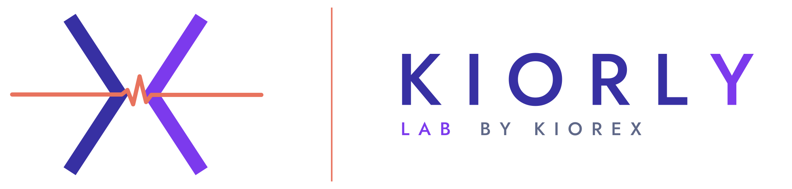

# Kiorly Lab

**A complete laboratory information system (LIS) for independent labs and small chains.**
Orders, accessioning, chain of custody, analyzers, Westgard QC, authorised release, critical values, billing and 22 reports. It runs fully on its own; connecting it to Kiorex, Kiorly Clinic and Kiorly Nurse is one optional setting.


[At a glance](#at-a-glance) · [Standalone vs Integrated](#standalone-vs-integrated) · [Features](#features) · [Architecture](#architecture) · [Screens](#screens) · [Plans](#plans-and-entitlements) · [Quick start](#quick-start) · [Tests](#tests) · [Docs](#where-to-read-next)

</div>

> **Synthetic data only.** Demo logins, URLs and reset steps: [Docs/TEST_DATA.md](Docs/TEST_DATA.md) (DEV ONLY, blocked in production).
> **Demo data for manual testing** (personas, counts, click-path test scripts, role checklists): [DEMO_DATA.md](DEMO_DATA.md) (DEV ONLY).

> **Status: MVP built, standalone LIS checklist done, mock providers only.** Schema is FROZEN-v1 (engineering freeze, human approval NH-LB-023 open). Open human items: [Docs/NEEDS_HUMAN.md](Docs/NEEDS_HUMAN.md).

---

## What and why

Kiorly Lab runs the whole path of a sample: an order is entered, the specimen is accessioned with a label and custody trail, results come from an analyzer (ASTM E1394 or HL7 v2) or manual entry, **QC is checked before anything is released**, a technologist and then a pathologist validate, and an authorised signatory releases a signed, versioned, bilingual report with a QR. Critical values escalate until someone acknowledges them. Around that sit reception queues, referrers and a doctor portal, microbiology and histopathology reporting, quality management (CAPA, EQA, SOPs), reagent inventory with automatic consumption, and billing with payer contracts. It is a **complete standalone LIS** (all ten areas of the [feature matrix](Docs/FEATURE_MATRIX.md)); with the integration switch on, Kiorex test bookings, Kiorly Clinic hand-offs and Kiorly Nurse home-collected samples flow in and results flow back, over HMAC REST and outbox webhooks.

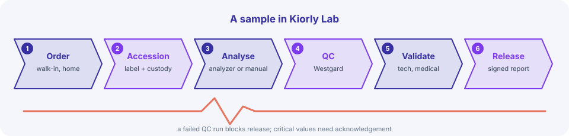

## At a glance

| | |
|---|---|
| **Product** | Kiorly Lab by Kiorex (accent Lab Violet `#7C3AED`); part of the Kiorly provider suite next to Kiorly Clinic and Kiorly Pharmacy |
| **API** | NestJS 12 + Prisma 7 + PostgreSQL 16, `:3200`, prefix `/api/v1`, Swagger at `/docs`, 98 Prisma models, 69 enums, 16 migrations |
| **Web** | React 19 + Vite 8 + Tailwind 4 + TanStack Query + i18next (Arabic and English, RTL), Vite `:5191`; lab console, collector PWA `/phleb`, patient secure link `/r/:token`, doctor portal `/portal/:token`, queue board `/queue-board`, report verify `/verify/:id` |
| **Roles** | `OWNER`, `LAB_DIRECTOR`, `AUTHORIZED_SIGNATORY`, `TECHNOLOGIST`, `PHLEBOTOMIST`, `RECEPTION`, `BRANCH_MANAGER`, `SUPERVISOR`, `FINANCE` |
| **Editions** | Lite, Pro, Chain (see [Plans](#plans-and-entitlements)) |
| **Mode** | `STANDALONE` (new self-serve labs) or `INTEGRATED` (existing tenants) |
| **Identity** | Dev token (`AUTH_MODE=dev`) or Kiorex Passport OIDC (audience `kiorly-lab`, MFA for privileged roles in production) |
| **Mobile** | A Kiorly mobile app (design in progress, see [Docs/MOBILE.md](Docs/MOBILE.md)) |
| **Providers** | All mocked (`MODE=mock`): messaging, PSP, object storage, analyzers, Kiorex |
| **Standing rule** | No tax-authority reporting, ever (ADR-011). VAT is a line on invoices and exports only; a CI test enforces it |

## Standalone vs Integrated

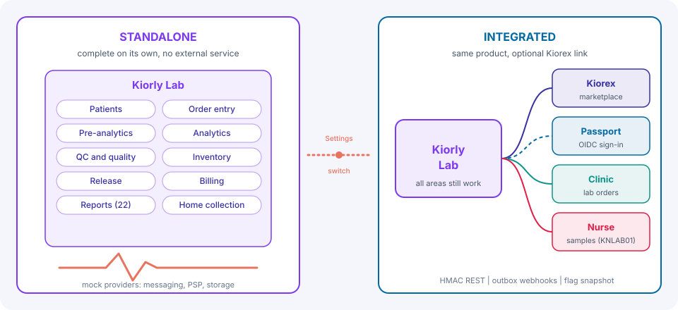

| | **STANDALONE** | **INTEGRATED** |
|---|---|---|
| Setting | **Settings > General > Operating mode** (`PUT /settings {integrationMode}`); new self-serve tenants start here | existing tenants keep this (migration default); switch any time |
| Orders in | reception, referring doctors, home collection, appointments | the same, plus Kiorex bookings, Kiorly Clinic hand-off and Kiorly Nurse samples (KNLAB01) over HMAC `/integration/v1/*` |
| Results out | printed, secure patient link, doctor portal, email, WhatsApp, SMS | the same, plus `LabResultReleased` and the other outbox events to Kiorex and the import channels |
| External traffic | none: integration requests get `403 INTEGRATION_DISABLED`, no outbox rows written | HMAC partners and outbox webhooks |
| Safety controls | Identical (QC block, medical validation, critical escalation, label match, consent, audit) | Identical |

Switching INTEGRATED to STANDALONE keeps pending outbox rows and does not replay events produced meanwhile. Registration of partners, stuck-event handling and the dev clients are in [Docs/RUNBOOK.md](Docs/RUNBOOK.md).

## Features

Status from [Docs/FEATURE_MATRIX.md](Docs/FEATURE_MATRIX.md) (files and tests per row live there): :white_check_mark: = API, web, tests and seed done; :test_tube: = done on a mock provider (the code path is real); :no_entry: = not possible, with the reason.

| # | Area | Highlights | Status |
|---|---|---|---|
| 1 | **Patients and referrers** | Registry independent of Kiorly, hashed national ID, history and cumulative trends, duplicate merge, append-only consent, referrer directory and commissions, doctor portal | :white_check_mark: delivery preferences :test_tube: |
| 2 | **Order entry** | Walk-in, referred, home, package, STAT, fasting; ICD-10 hints; edits with revisions; Code 128, QR and ZPL labels; appointments with capacity; reception queue and TV board | :white_check_mark: |
| 3 | **Pre-analytics** | Accessioning and custody, rejection with reasons and recollection, aliquoting, storage racks, retention and disposal, transport manifests and courier tracking | :white_check_mark: |
| 4 | **Analytics** | Worklists, analyzer interface (HL7 and ASTM plus simulator), derived tests, age and sex reference ranges, delta checks, auto-verification, reruns, panels, microbiology, histopathology, amendments | :white_check_mark: |
| 5 | **QC and quality** | Levey-Jennings and Westgard, QC lots, calibration, EQA with z-score, maintenance, NCR and CAPA, document control, SOP acknowledgements, audit viewer | :white_check_mark: |
| 6 | **Inventory** | Reagent lots and expiry, automatic FEFO consumption per run (a shortfall never blocks a result), reorder, POs, goods receipt, counts, cost per test | :white_check_mark: |
| 7 | **Reporting and release** | Pathologist sign-off, consent-checked release, critical acknowledgement and escalation, bilingual templates with QR and PDF, cumulative reports, QR verification page | :white_check_mark: delivery :test_tube: |
| 8 | **Billing and finance** | Price lists, invoices, partial payments, cash close, B2B and insurance contracts, discounts with approval, payer settlements, refunds, receivables aging, expenses, 11 CSV and PDF exports, VAT as lines only | :white_check_mark: |
| 9 | **Admin and analytics** | Staff and role matrix (9 roles), branches and sections, settings, catalogue CSV import, TAT dashboards, **22 report types** | :white_check_mark: |
| 10 | **Integration optional** | Standalone is first-class; Kiorex orders in, results out, nurse samples | :white_check_mark: |
| - | **Home collection** | Collector route and safety timer, SOS, unsafe-abort on `@kiorly/field-visit` | :white_check_mark: `lab.home_collection` |
| - | Antimicrobial breakpoints (CLSI or EUCAST), full ICD-10 and SNOMED | Licensed material; the bench enters S/I/R from its own tables | :no_entry: |
| - | Live analyzer hardware, real label printers, real messaging and PSP | Parsers and simulator are real; hardware and providers wait for the go-live pass | :hourglass_flowing_sand: [NEEDS_HUMAN](Docs/NEEDS_HUMAN.md) |

<details>
<summary><b>Deep dive: QC gate, validation and release</b></summary>

- A **failed QC run opens a `QcBlock`**: unreleased results from that run go back to analysis, and clearing needs a documented passing run (`qc.clear_block`). Calculated tests inherit the block from their inputs.
- **Two validation steps**: technologist validation, then medical validation by an `AUTHORIZED_SIGNATORY` or `LAB_DIRECTOR`. Auto-verification is off by default and, when enabled, passes only normal results with QC pass and no delta violation.
- **Release** renders the report once at signing with the active template and stores it; later template changes never alter a signed report. Corrections create a new version, and the QR on every report opens `/verify/:id` (genuine or superseded, no patient data).
- **Critical values** (per-test list, acknowledgement window and escalation chain are pathologist sign-offs, NH-LB-006) escalate until acknowledged; notifications never carry raw values.
</details>

<details>
<summary><b>Deep dive: home collection and nurse-collected samples</b></summary>

Home collection runs on the vendored `@kiorly/field-visit` package: coverage, buffers, address privacy and the phlebotomist safety protocol (never switchable), see [Docs/FIELD_VISIT.md](Docs/FIELD_VISIT.md). A sample a Kiorly Nurse collects against a doctor's lab order (KNLAB01) arrives as a `LabOrderPlaced` event; custody starts at collection time (type, time, transport temperature, who) and the released report link goes back to the nurse without result values, see [Docs/NURSE_SAMPLES.md](Docs/NURSE_SAMPLES.md).
</details>

## Architecture

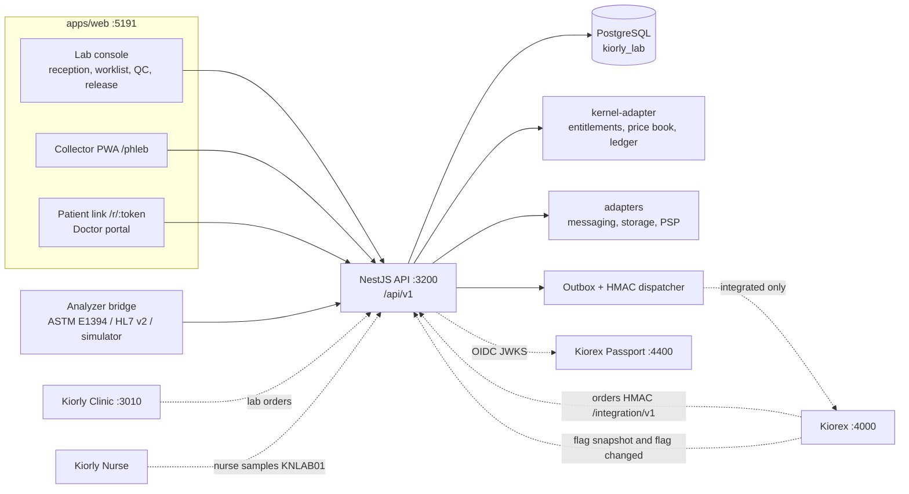

Modules (`apps/api/src/modules`): `catalogue`, `registry`, `orders`, `reception`, `field-safety`, `preanalytics`, `specimens`, `analysis-qc`, `analyzers`, `microbiology`, `histopathology`, `quality`, `inventory`, `critical`, `release`, `business`, `analytics`, `admin`, `mobile`, `mobile-alerts`. Seam folders: `kernel-adapter` (for `@kiorly/commerce-kernel`, not published yet), `adapters`, `outbox`, `integration`.

### Key flow: order to released report

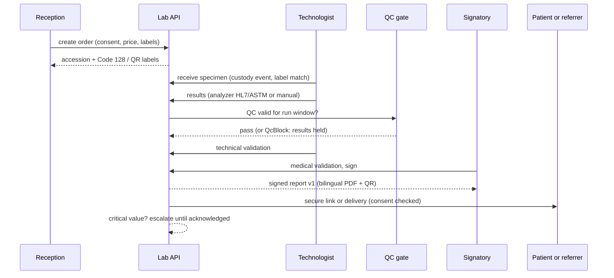

### Data model overview

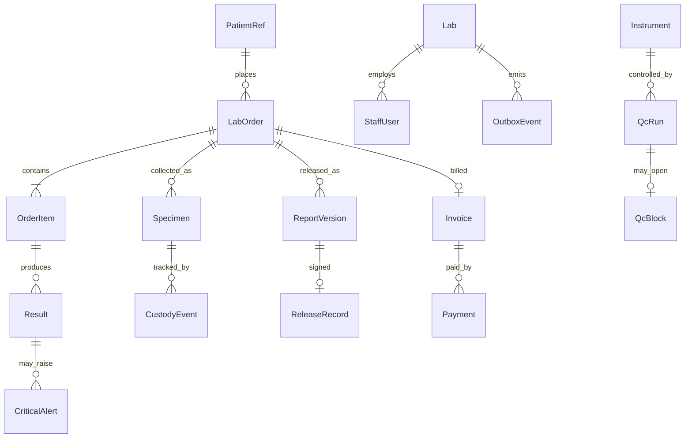

98 models in [`apps/api/prisma/schema.prisma`](apps/api/prisma/schema.prisma) (FROZEN-v1). Append-only tables (audit, custody, QC runs, ledgers, stock movements, refunds, consents, report versions) are protected by DB triggers; migrations `0001_draft_init` and `0002_freeze_v1` add the safety `CHECK`s.

### Roles and permissions

Guards check permissions in `apps/api/src/auth/rbac.ts`. Privileged roles (owner, lab director, authorised signatory) need an MFA claim when enforcement is on (always in production). Tenant isolation is separate from permissions.

| Capability | Owner / Director | Signatory | Tech | Phleb | Reception | Supervisor | Manager | Finance |
|---|:-:|:-:|:-:|:-:|:-:|:-:|:-:|:-:|
| Create and edit orders | :white_check_mark: | | | | :white_check_mark: | :white_check_mark: | :white_check_mark: | |
| Collect and label specimens | :white_check_mark: | | :white_check_mark: | :white_check_mark: | :white_check_mark: | :white_check_mark: | | |
| Enter results, run QC | :white_check_mark: | | :white_check_mark: | | | :white_check_mark: | | |
| Clear a QC block | :white_check_mark: | :white_check_mark: | | | | :white_check_mark: | | |
| **Medical validation and sign** | :white_check_mark: | :white_check_mark: | | | | | | |
| Release and deliver reports | :white_check_mark: | :white_check_mark: | | | :white_check_mark: | :white_check_mark: | | |
| Invoices, payments, cash close | :white_check_mark: | | | | :white_check_mark: | | :white_check_mark: | :white_check_mark: |
| Pricing, commissions, expenses | :white_check_mark: | | | | | | :white_check_mark: | :white_check_mark: |
| Quality (CAPA, documents) | :white_check_mark: | :white_check_mark: | :white_check_mark: | | | :white_check_mark: | :white_check_mark: | |
| Staff, settings | :white_check_mark: | | | | | | staff only | |

## Screens

Captured from the running app with synthetic data (English, light theme first, then Arabic RTL and the collector phone view). The full before and after sets are in the workspace `_docs/ui-review/lab/`.

| Dashboard | Orders | Worklist |
|---|---|---|
| 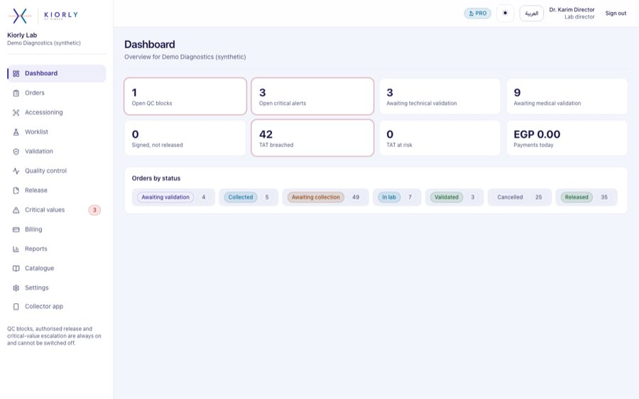 | 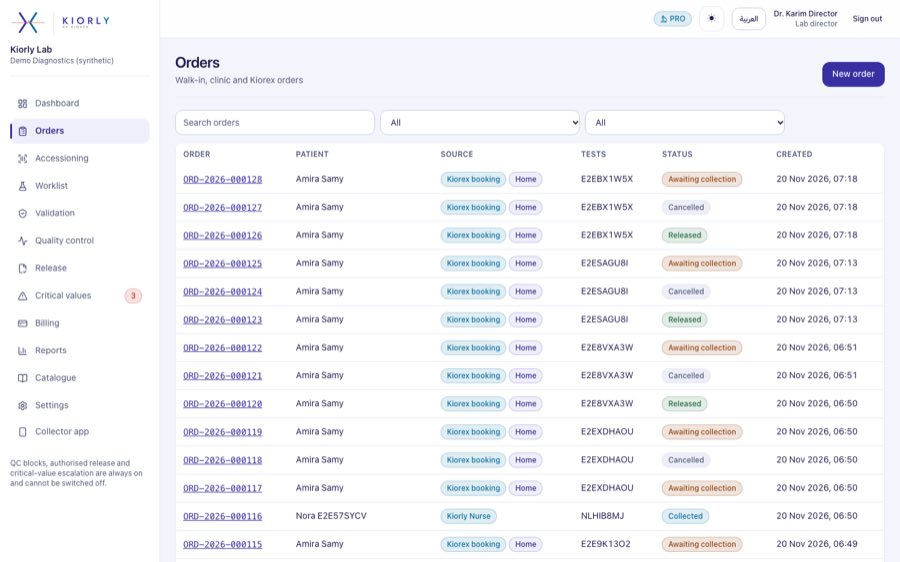 | 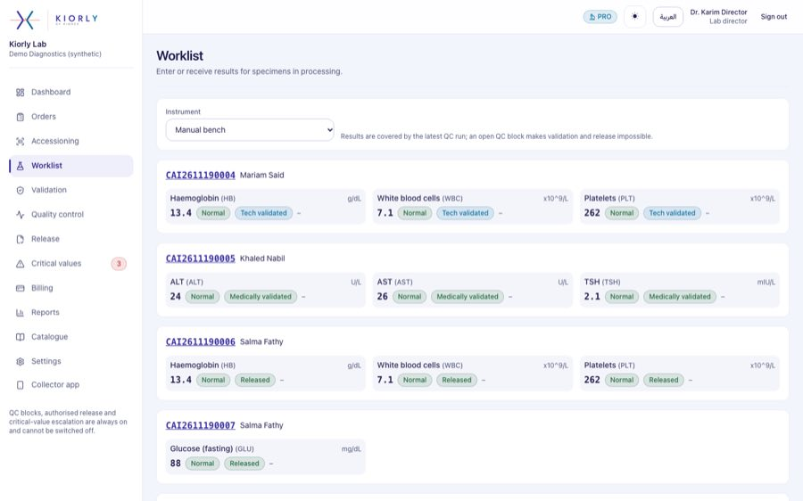 |

| QC | Validation | Critical values |
|---|---|---|
| 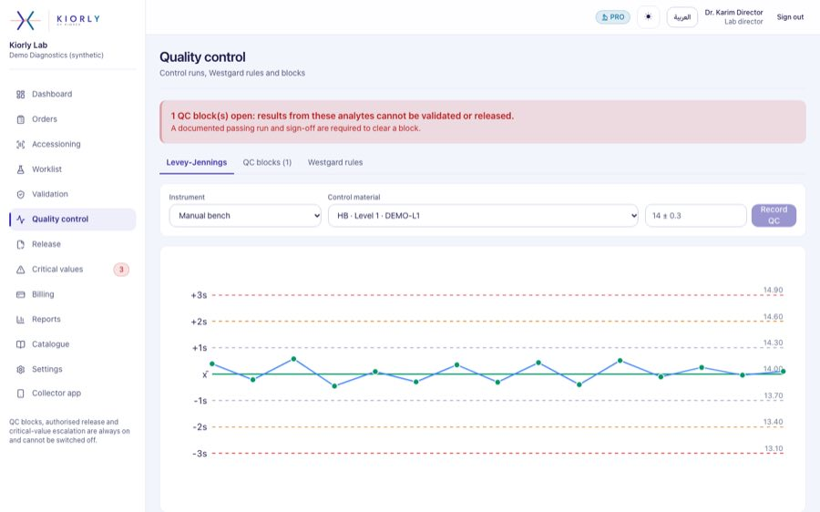 | 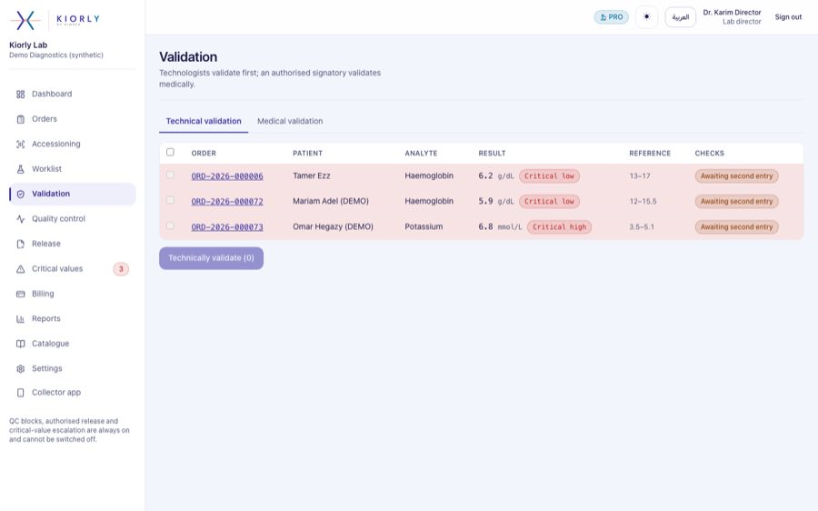 | 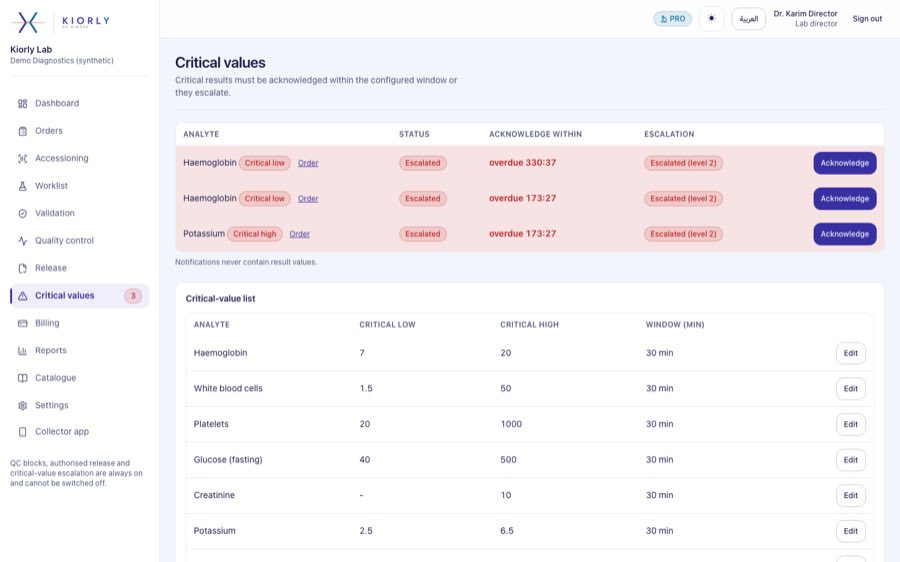 |

| Billing | Arabic dashboard (RTL) | Collector (phone) | Sign in |
|---|---|---|---|
| 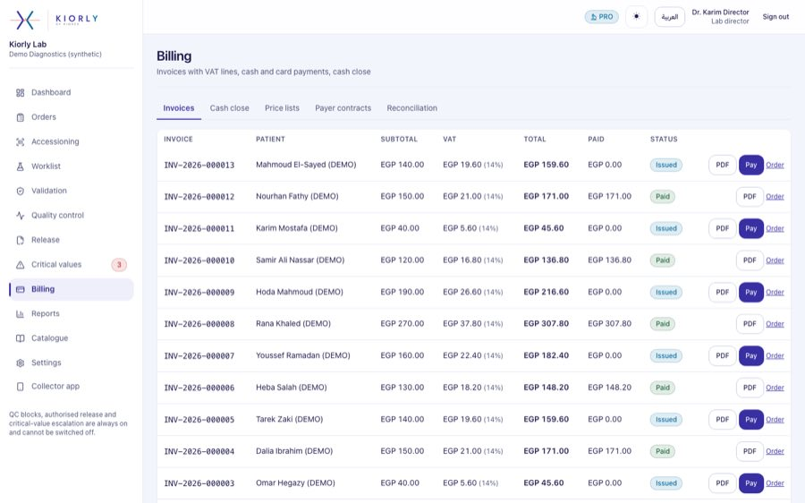 | 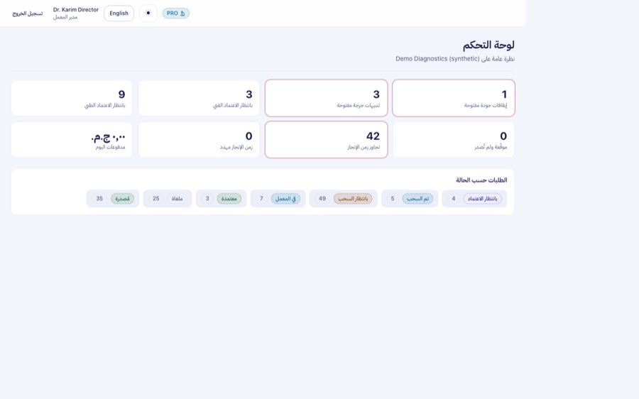 | 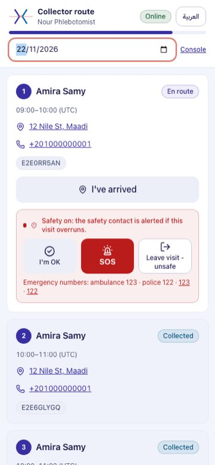 | 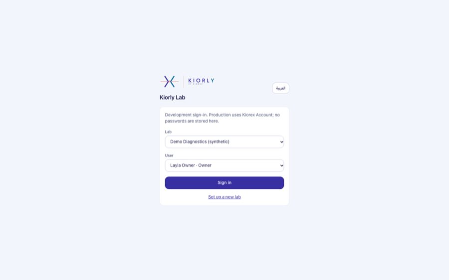 |

## Plans and entitlements

From `apps/api/src/kernel-adapter/local-kernel.ts` (KX-07 §02). Pricing is not decided by engineering (NH-LB-004). Safety controls are in every edition and are not capabilities. Plan gates answer `402`; feature flags are separate and answer `403 FEATURE_DISABLED`.

| Capability | Lite | Pro | Chain |
|---|:-:|:-:|:-:|
| Kiorex bookings (`kiorex_bookings`) | :white_check_mark: | :white_check_mark: | :white_check_mark: |
| Analyzer interfaces (`analyzer_interfaces`) | | :white_check_mark: | :white_check_mark: |
| Home collection (`home_collection`) | | :white_check_mark: | :white_check_mark: |
| Referral labs (`referral_labs`) | | :white_check_mark: | :white_check_mark: |
| Multi-branch (`multi_branch`) | | | :white_check_mark: |

<details>
<summary><b>Feature flags and safety controls</b></summary>

Flags `lab.module`, `lab.analyzer_interfaces`, `lab.home_collection`, `lab.kiorex_bookings` are evaluated locally from the Kiorex snapshot (cached in `FlagSnapshotCache`, polled every 30 s with `If-None-Match`, refreshed by the signed `flag.changed` webhook). OFF answers `403 FEATURE_DISABLED {key, scope}` and never hides data. The Kiorex-side `kiorex.lab_bookings` is launch-locked behind counsel and pathologist gate evidence (NH-LB-014, NH-LB-015) that only a human records.

**Safety controls are never flags** (ADR-025): QC blocks, authorised release, critical-value escalation, accession uniqueness, chain of custody, label match, consent, audit, tenant isolation, privileged MFA. See [Docs/ADR_REFERENCE.md](Docs/ADR_REFERENCE.md); `flags-off.e2e.test.ts` proves all four flags and the never-flag rule.
</details>

### Stack versions (upgraded 20 Nov 2026)

| Layer | Version |
|---|---|
| Runtime | Node.js 26 LTS (`.nvmrc`), npm 11+, Lambda `nodejs24.x` |
| Language | TypeScript 6.0 |
| API | NestJS 12, `@nestjs/swagger` 12, Express 5, class-validator 0.15, jose 6, pdfkit 0.21 |
| Data | Prisma 7 (`prisma-client` generator, `@prisma/adapter-pg`), PostgreSQL 16 |
| Web | React 19, Vite 8, Tailwind CSS 4, TanStack Query 5, i18next 27, react-i18next 18 |
| Tooling | ESLint 10.15, typescript-eslint 8, Playwright 1.65, tsx, swc (test runner) |

Upgrade log, pinned items and what unblocks them: [Docs/UPGRADE_NOTES.md](Docs/UPGRADE_NOTES.md).

## Quick start

Prerequisites: Node 26 LTS (`nvm use`, see `.nvmrc`) and npm 11+, the workspace Postgres on `:5433` (see the workspace [README](https://github.com/mshall/kiorex-workspace)).

```bash
npm install
cp .env.example apps/api/.env       # DATABASE_URL points to kiorly_lab on :5433; never commit .env
npm run prisma:generate -w api      # Prisma 7 client -> apps/api/src/generated (gitignored)
npm run db:setup                    # creates kiorly_lab + kiorly_lab_test, applies migrations
npm run db:seed -w api              # synthetic demo tenant "demo-lab" plus the LIS dataset (idempotent, guarded)
npm run dev                         # API :3200 + web :5191
```

| Service | URL | Notes |
|---|---|---|
| API | http://localhost:3200/api/v1 | `/health/live`, `/health/ready`, Swagger at `/docs` |
| Web | http://localhost:5191 | proxies `/api` |
| Database | `127.0.0.1:5433` | `kiorly_lab` (tests use `kiorly_lab_test`) |

Sign in at the web URL with dev auth as the **Demo Diagnostics (synthetic)** lab; users, roles and the dev HMAC partner clients (`kl_dev_kiorex`, `kl_dev_clinic`, `kl_dev_nurse`) are listed in [Docs/TEST_DATA.md](Docs/TEST_DATA.md). The seed also leaves an open QC block, a critical haemoglobin alert and a home-collection route for today. Seeds need `DEMO_SEED_ALLOWED=true` and a non-production environment. If another process owns a port, run beside it with `PORT=3201` and `LAB_WEB_PORT=5192 LAB_API_ORIGIN=http://127.0.0.1:3201`.

## Tests

```bash
npm run typecheck          # api (prisma generate + tsc) + web
npm run lint               # web
npm test                   # api unit + e2e on kiorly_lab_test, then web locale parity and i18n coverage
npm run docs:check
npm run openapi -w api     # regenerates Docs/openapi.json
npm run e2e -w web         # Playwright golden flow in system Chrome (own API/web on the test DB)
```

| Suite | Count | Notes |
|---|---|---|
| API unit (`*.node.test.ts`) | **109 passing** (20 Nov 2026) | Westgard, formula language, parsers, aging, stock math, QR, CSV, no-tax-authority |
| API e2e (`apps/api/test/*.e2e.test.ts`) | 22 files, 143 tests at the last full run (see [FEATURE_MATRIX](Docs/FEATURE_MATRIX.md)) | real DB; includes `safety-stop-ship`, `flags-off`, `tenancy-rbac`, `nurse-samples`, `integration` |
| Web | 6 unit plus 2 Playwright specs | locale parity, golden flow, LIS smoke |

Highlights: the KX-07 stop-ship suite (QC violation injection, critical timer, label mismatch, duplicate accession replay), OFF-contract tests for all four flags, Westgard property tests, ASTM and HL7 fixture parsers, contract tests against `@kiorex/contracts`, and money-path idempotency with reconciliation.

## Environment variables

Authoritative list in [`.env.example`](.env.example) (dev defaults, never reuse in staging or production).

| Variable | Purpose | Default (dev) |
|---|---|---|
| `DATABASE_URL`, `PORT` | Postgres and API port | workspace cluster `kiorly_lab`, `3200` |
| `AUTH_MODE` | `dev` (HS256 dev tokens, never production) or `oidc` (Passport JWKS) | `dev` |
| `JWT_DEV_SECRET` | Dev token signing | dev only |
| `KIOREX_OIDC_ISSUER`, `KIOREX_OIDC_AUDIENCE` | Passport issuer and audience | local Passport, `kiorly-lab` |
| `MESSAGING_MODE`, `PSP_MODE`, `STORAGE_MODE`, `ANALYZER_MODE`, `KIOREX_MODE` | Provider adapters (`mock` or `real`) | `mock` |
| `STORAGE_DIR`, `PUBLIC_BASE_URL` | Local object storage, public link base | `./.data/storage`, web URL |
| `KIOREX_WEBHOOK_URL`, `KIOREX_WEBHOOK_SECRET` | Outbox target and HMAC secret | dev values from the workspace `INTEGRATION.md` |
| `KIOREX_FLAGS_WEBHOOK_SECRET` | `flag.changed` webhook secret | dev only |
| `INTEGRATION_KEK` | Key-encryption key for partner secrets | dev only |
| `DEMO_SEED_ALLOWED` | Allows the synthetic seeds | dev only |

## Folder map

```text
kiorly-lab/
├── apps/
│   ├── api/         NestJS API: src/modules/*, auth, outbox, integration, kernel-adapter, adapters
│   │   ├── prisma/  FROZEN-v1 schema, 16 migrations, seeds
│   │   └── test/    e2e (real DB), fixtures
│   └── web/         React + Vite: console, collector PWA, patient link, doctor portal, e2e/
├── packages/shared  product constants, flag keys, safety controls
├── Docs/            hub, matrix, runbook, API, mobile, field visit, nurse samples, ADRs, assets/
├── infra/           OpenTofu (separate; nothing applied)
├── scripts/         docs check, db and seed helpers
└── vendor/          vendored @kiorly/field-visit and contracts tarballs
```

## Security notes

- **Tenant isolation** on every table plus a guard; privileged MFA in production.
- **Append-only and trigger-protected** audit, custody, QC, ledger, consent and report-version tables; restore from DB backups, never by editing rows.
- **Reports are immutable once signed**; secure links store only token hashes and expire (default 30 days, OTP-protected); doctor-portal links are revocable and need the patient's consent.
- **No PHI in logs, labels or notifications beyond what policy allows**; delivery messages carry links, never values.
- **No secrets in git**: `.env` ignored; dev HMAC clients and demo logins live only in seeds and [Docs/TEST_DATA.md](Docs/TEST_DATA.md).
- **Mocks by default**: messaging, PSP, storage, analyzers and Kiorex stay mock until the go-live pass ([Docs/NEEDS_HUMAN.md](Docs/NEEDS_HUMAN.md), "Provider go-live").
- **No tax-authority integration** of any kind (ADR-011).

## Glossary

| Term | Meaning |
|---|---|
| **LIS** | Laboratory information system |
| **Accession** | The unique lab identifier given to a received specimen |
| **Chain of custody** | Append-only record of who held a specimen, when and at what temperature |
| **Westgard rules** | QC rules (1-3s, 2-2s, R-4s, 4-1s, 10x) deciding if a run is valid |
| **QC block** | Hold that stops release of results from a failed QC run until cleared |
| **Delta check** | Comparison with the patient's previous result to catch swaps and errors |
| **Medical validation** | Pathologist-level approval before a report can be released |
| **Critical value** | A result needing urgent acknowledgement and escalation |
| **KNLAB01** | A nurse collects a sample against a doctor's order and hands it to the lab |
| **Never-flag** | A safety control no feature flag can switch off (ADR-025) |

## Where to read next

| Read | For |
|---|---|
| [Docs/README.md](Docs/README.md) | Documentation hub and the standalone-vs-integrated rules |
| [Docs/FEATURE_MATRIX.md](Docs/FEATURE_MATRIX.md) | The ten-point LIS checklist with files and tests |
| [Docs/RUNBOOK.md](Docs/RUNBOOK.md) | Ports, seeds, integration modes, QC, inventory, retention, backups |
| [Docs/API.md](Docs/API.md) · [Docs/openapi.json](Docs/openapi.json) | Auth, errors, idempotency, outbox events, module map |
| [Docs/FIELD_VISIT.md](Docs/FIELD_VISIT.md) | Home collection and collector safety (`@kiorly/field-visit`) |
| [Docs/NURSE_SAMPLES.md](Docs/NURSE_SAMPLES.md) | Nurse-collected samples (KNLAB01) |
| [Docs/MOBILE.md](Docs/MOBILE.md) | Backend contract for the Kiorly mobile app (design in progress) |
| [Docs/TEST_DATA.md](Docs/TEST_DATA.md) | Synthetic QA data, logins, reset |
| [Docs/NEEDS_HUMAN.md](Docs/NEEDS_HUMAN.md) | Open decisions, pathologist and counsel sign-offs, provider go-live |
| [Docs/ADR_REFERENCE.md](Docs/ADR_REFERENCE.md) | Binding ADRs and the ADR-025 safety controls |
| [Docs/lab-cursor-build-sequence.md](Docs/lab-cursor-build-sequence.md) | 45 build steps and progress tracker |
| [Docs/DESIGN_NOTES_FROM_2025.md](Docs/DESIGN_NOTES_FROM_2025.md) | Entity ideas harvested from the 2025 prototypes |

## Rules and contributing

Conventional Commits with KL requirement IDs (for example `feat(qc): KLQC02 Westgard block`). Run `npm run typecheck && npm test && npm run docs:check` first. See `.cursor/rules/lab.mdc` and the workspace `CLAUDE.md`. Stop and ask a human for prices, VAT, clinical or consent wording, marking a launch gate satisfied, production credentials, and breaking a published contract. No push to `main` without review; **no AWS deploys until the founder says so**.

## Brand ("Kiorly Lab by Kiorex")

Palette, typography and logo come from the shared Kiorex brand kit (`_brand/` in the workspace), vendored into `apps/web/src/brand` (tokens, Tailwind preset, `KiorexLogo`, shared primitives in `ui-kit.tsx`: PageHeader, StatCard, StatusChip, EmptyState, FormField, Stepper, Skeleton, ThemeToggle). The product line is `KIORLY_PRODUCT = "lab"`: Lab Violet `#7C3AED` recolours the right chevron, the Y of KIORLY and the whole word Lab; Indigo stays the primary action colour. `brand-bridge.css` maps the shadcn-style HSL variables onto the brand tokens (light and designed dark; theme = light/dark/system via `kx-theme`). Jost and IBM Plex Sans Arabic are bundled with `@fontsource`. Never redraw the logo. Console primitives on top of the kit live in `apps/web/src/components/kit.tsx` (SearchBox, Segmented queue filters, PriorityChip with STAT affordances, BulkBar, LabelPreview, PdfPreview); `node apps/web/scripts/axe-check.mjs` covers every page, dialog and the signed-out pages at desktop and 390 px, AR and EN, light and dark. Before and after screenshots: `_docs/ui-review/` (`node apps/web/scripts/ui-shots.mjs before|after`).

<div align="center"><sub>Private repository. Part of Kiorex v2: 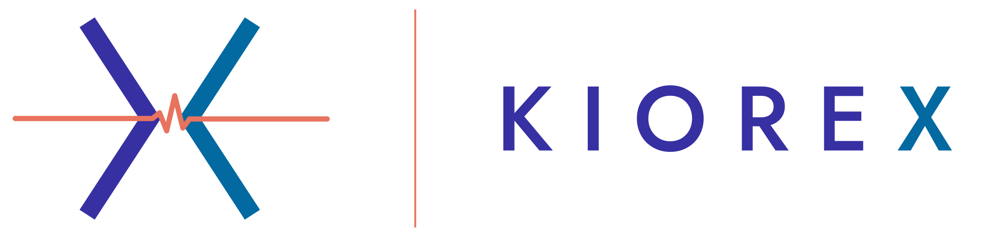</sub></div>
